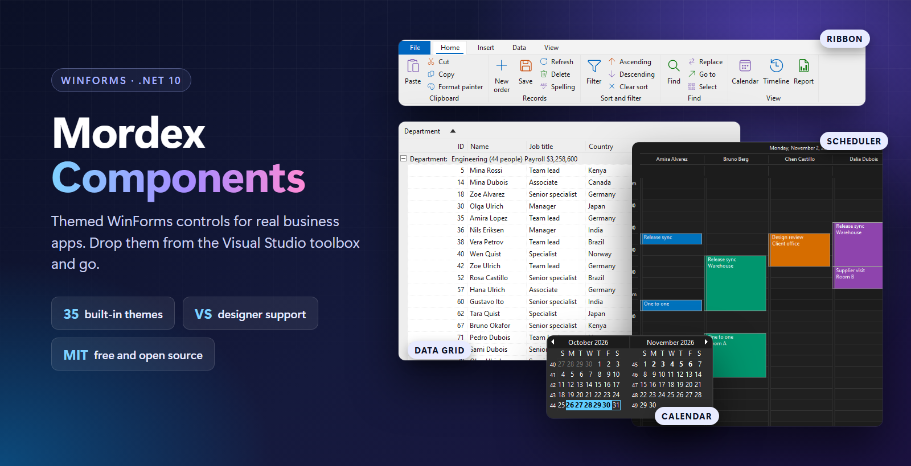
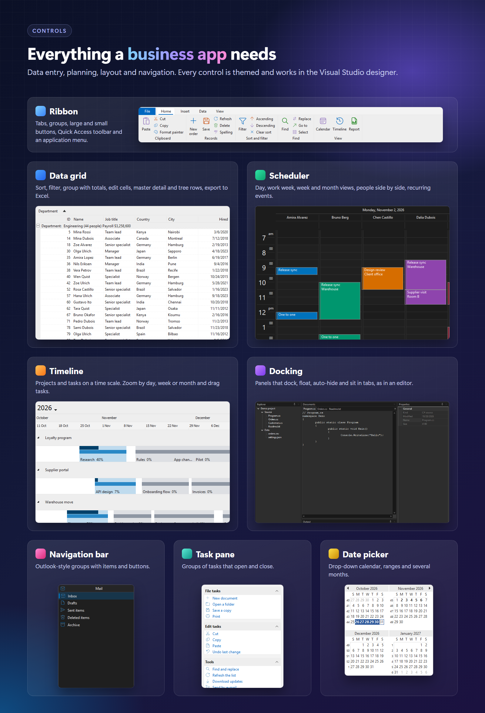
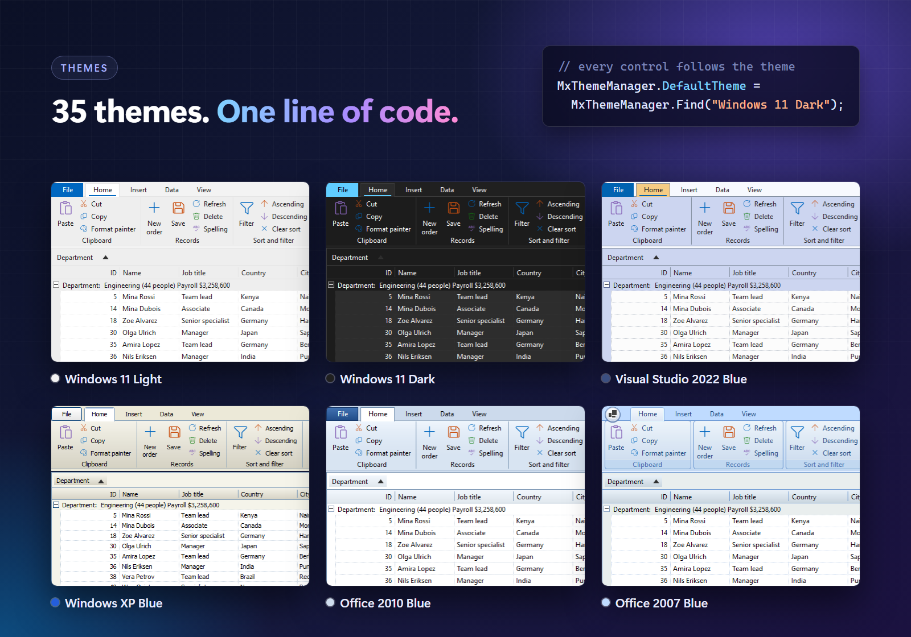

<div align="center">


# Mordex Components

**WinForms controls for .NET 10 with Visual Studio designer support.**

A data grid, ribbon, navigation bar, task pane, date picker, scheduler, timeline, docking and more.<br>
Free and open source under the MIT License.

[](LICENSE)


[](https://github.com/ehsanenaloo/Mordex-Components/actions/workflows/build.yml)

[Controls](#controls) · [Screenshots](#screenshots) · [Themes](#themes) · [Install](#install) · [Build](#build) · [Demo](#demo-and-smoke-test) · [Contributing](#contributing)

</div>



## Controls

| Control | What it does |
| --- | --- |
| **MxDataGrid** | A data grid with cell editors. |
| **MxRibbon** | A ribbon with tabs and groups. |
| **MxNavigationBar** | A navigation bar. |
| **MxTaskPane** | A task pane with groups. |
| **MxDatePicker** | A date picker with a drop-down calendar. |
| **MxScheduler** | A scheduler for appointments. |
| **MxTimeline** | A timeline for dated events. |
| **Docking, command bars, tabs** | Docking panels, command bars, tab controls and the basic controls in `Mordex.Windows.UI`. |

## Screenshots





## Themes

All controls follow one theme. There are 35 built-in themes: Windows 11 and 10, Visual Studio 2022, Office 365, Chrome and Firefox in light and dark, and older looks such as Windows Classic, Windows XP and Office 2003 to 2010.

```csharp
using Mordex.Windows.Common;

MxThemeManager.DefaultTheme = MxThemeManager.Find("Windows 11 Dark");
```

`MxThemedFormFrame` draws the window caption and border in the style of the theme.

## Install

The controls ship as one NuGet package, `Mordex.Windows`, for `net10.0-windows`.

```bash
dotnet add package Mordex.Windows
```

The package includes the out-of-process designer, so the controls appear in the Visual Studio toolbox and can be edited on the design surface.

## Build

You need the .NET 10 SDK and Windows.

```bash
./build.ps1            # or ./build.sh
dotnet build Mordex.sln -c Release
```

Assemblies are copied to `artifacts/bin`.

## Demo and smoke test

```bash
dotnet run --project demo/Mordex.Demo
dotnet run --project demo/Mordex.Demo -- --smoke
```

`--smoke` creates every control, prints one line per control, and exits with 1 if any fails.

## Documentation

| | |
| --- | --- |
| [Changelog](CHANGELOG.md) | What changed in each release |
| [Contributing](.github/CONTRIBUTING.md) | Setup, checks and how to send a change |
| [Security](.github/SECURITY.md) | How to report a vulnerability |
| [Support](.github/SUPPORT.md) | Where to ask for help |

## Contributing

Bug reports and small pull requests are welcome. Read [CONTRIBUTING.md](.github/CONTRIBUTING.md) first. It explains how to build the project and run the checks.

## Contributors

Thanks to everyone who has helped. Your name appears here after your first merged contribution.

[](https://github.com/ehsanenaloo/Mordex-Components/graphs/contributors)

## License

[MIT](LICENSE) © 2026 [Ehsan Enaloo](https://www.enaloo.com).
